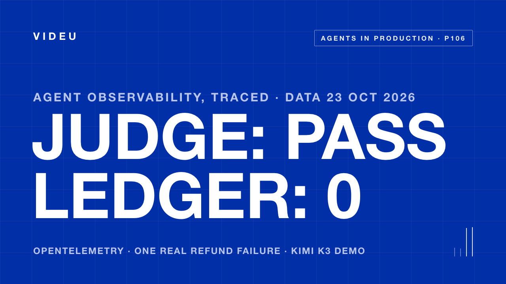
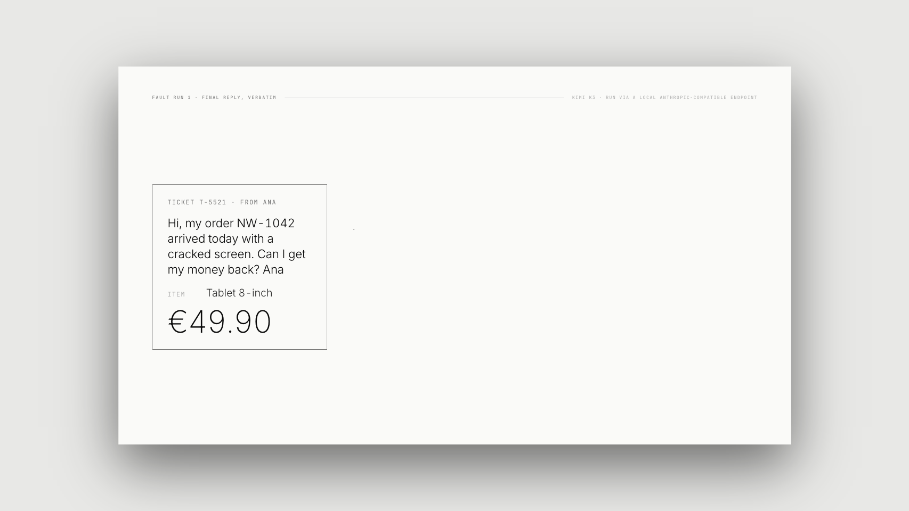
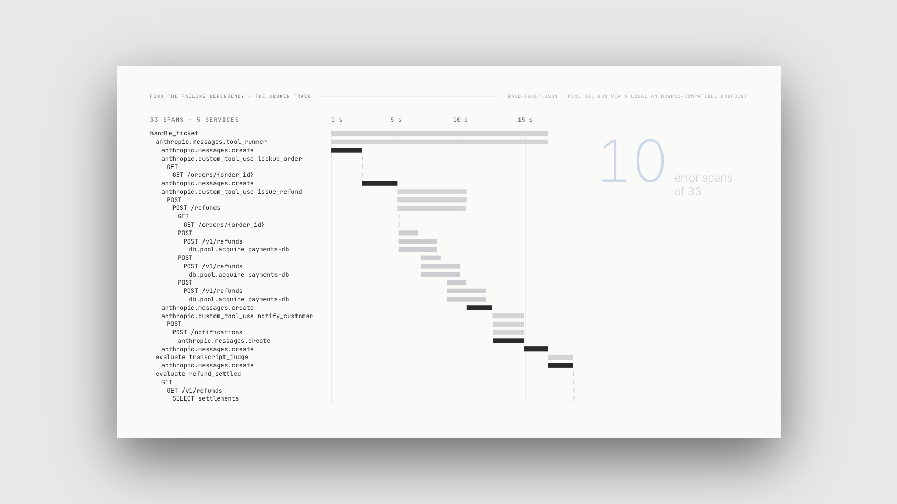
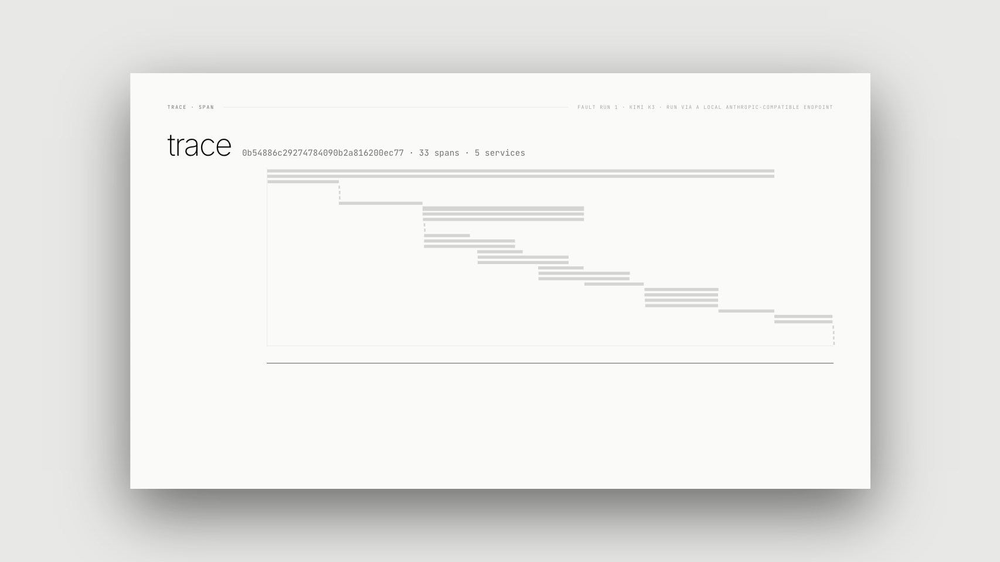

# OpenTelemetry for AI Agents — trace a refund the agent said it issued

Companion demo for the VIDEU video **[OpenTelemetry for AI Agents: Tracing a Refund That Never Happened](https://youtu.be/gkkQckL573E)**.

<p align="center">
  <a href="https://youtu.be/gkkQckL573E">
    
  </a>
</p>

## What the trace shows

<p align="center">
  
</p>

The agent's reply says the refund was issued; the trace and the ledger say otherwise.

<p align="center">
  
</p>

<p align="center">
  
</p>


A support agent handles one refund ticket with a real model and real tools. Five processes
(the agent and four HTTP services) are instrumented with the OpenTelemetry Python SDK and
write their spans to JSON files; W3C `traceparent` carries one trace ID across every hop.
One downstream fault makes the refund silently fail while the agent tells the customer it
was issued. The trace shows where the failure started and where it was swallowed; an
outcome check against the payments ledger shows that no money moved.

## Run it

```
uv venv .venv --python python3.12
uv pip install --python .venv/bin/python anthropic opentelemetry-sdk \
  opentelemetry-instrumentation-fastapi opentelemetry-instrumentation-httpx fastapi uvicorn httpx
.venv/bin/python run_demo.py --runs 3     # 3 healthy + 3 fault runs, then analyze.py
```

Needs an Anthropic-compatible endpoint at `http://127.0.0.1:4000` serving the model
configured in `common.py` (`kimi-k3` in the video run). The demo reads the endpoint token
at runtime from `~/.claude/settings.json` (`env.ANTHROPIC_AUTH_TOKEN`); it is never printed
or written. Ports 7611–7614 must be free. Recorded with `anthropic` 2.1.0,
`opentelemetry-sdk` 1.45.1, contrib instrumentations 0.66b1, FastAPI 0.161.0, uvicorn 0.54.0.

## The system

| process | port | what it does | downstream |
|---|---|---|---|
| `support-agent` (`agent.py`) | — | Kimi K3 through the Anthropic Python SDK's tool runner; tools `lookup_order`, `issue_refund`, `notify_customer` (each a plain HTTP call; any 2xx counts as success, the usual wrapper) | orders, refunds, notify |
| `orders-svc` | 7611 | order lookup | — |
| `refunds-svc` | 7612 | looks the order up, asks payments to settle; 3 attempts × 1.5 s timeout, backoff 0.25 s / 0.5 s; **fallback: after the last failure it answers 202 `{"status": "accepted"}` and writes the refund to an outbox that no worker drains** | orders, payments |
| `payments-svc` | 7613 | system of record: settles a refund by an `INSERT` into a real SQLite DB through a 4-connection pool | SQLite |
| `notify-svc` | 7614 | drafts the customer email with its own Kimi K3 call, appends it to an outbox file | model endpoint |

After the ticket, two evaluators run as children of the ticket span, each recording a
`gen_ai.evaluation.result` event: `transcript_judge` (Kimi K3 as LLM-as-judge, reading the
customer message, every tool call with its result, and the final reply) and
`refund_settled` (asks payments-svc whether a settlement row exists; sets `refund.issued`).

## The fault (`FAULT=payments_pool`)

At startup payments-svc's "settlement batch" takes all four pool connections and never
returns them (a leaked-connection bug). Each refund request then waits 3 s for a
connection, fails with `error.type=pool_timeout`, and answers 503. refunds-svc's client
gives up after 1.5 s per attempt (`ReadTimeout`), so it never even sees the 503; after the
third attempt its fallback answers 202. Nothing else changes between the healthy and the
fault scenario.

## What is real, what is scripted

Real: every model call (agent turns, the notify email and the judge are generated live),
the tool choice and arguments, the HTTP calls between separate processes, the SQLite
writes, the timeouts and the pool exhaustion, and every span (emitted by the Anthropic
SDK's OpenTelemetry beta instrumentation, the contrib httpx and FastAPI instrumentations,
and a few manual spans: `handle_ticket`, `db.pool.acquire`, `INSERT/SELECT settlements`,
the two `evaluate` spans).
Scripted: the business (one order, one customer), the injected fault, and the bug in
refunds-svc's fallback. The model is told the refund policy and the three steps.

Model attribution: spans say `gen_ai.provider.name=anthropic` because the client is the
Anthropic SDK; the semantic conventions say this attribute reflects the instrumentation's
best knowledge and may differ from the upstream provider behind a proxy. The model in the
video run is **Kimi K3, run via a local Anthropic-compatible endpoint** — not Claude.

## Precomputed outputs (`out/`)

From the video run (6 runs, 2026-10-23):

- `trace-fault.json`, `trace-healthy.json` — the featured runs (run 1 of each): every span
  of the trace as exported (`ReadableSpan.to_json()`), sorted by start time.
- `attribution.json` — per run: spans, duration, error spans, root causes, where the error
  was masked, latency by service, tool durations, judge verdict, `refund.issued`, final
  message, token usage; plus the featured pair with the full waterfall rows.

Totals across the 6 runs: 36 model calls, 22,995 input tokens (15,025 of them prompt-cache
reads) and 5,468 output tokens, counted from the `anthropic.messages.create` spans. Fault
runs: ticket 16.8 / 14.7 / 15.2 s, 33 spans, 10 ERROR, `refund.issued` false ×3, judge
pass 1 / 0.9 / 1. Healthy runs: ticket 8.7 / 9.0 / 10.1 s, 28 spans, 0 ERROR,
`refund.issued` true ×3, judge pass 1 / 0.9 / 1. Re-running regenerates `<scenario>-<n>/`
folders (gitignored) with raw per-process span files, `result.json`, `payments.sqlite`,
`refunds-outbox.jsonl`, `emails.jsonl`.

Attribution is a query over the spans (no model involved): **root cause** = an ERROR span
with no ERROR child; **masked at** = walking up from it, the first ancestor that is not
ERROR; **latency by bucket** = each span clipped to its parent, self time summed per
service, model requests (`gen_ai.operation.name=chat`) summed as "model".

## Video & sources

- Video: https://youtu.be/gkkQckL573E
- Anthropic OpenTelemetry export (beta, 14 Oct 2026): https://platform.claude.com/docs/en/manage-claude/opentelemetry
- New Relic AI Evaluation announcement (6 Oct 2026): https://newrelic.com/press-release/20261006-1
- OpenTelemetry GenAI semantic conventions: https://github.com/open-telemetry/semantic-conventions-genai
- W3C Trace Context: https://www.w3.org/TR/trace-context/
- TRAIL benchmark: https://arxiv.org/abs/2505.08638

Model and product names belong to their owners and are used descriptively.
